

  <a href="https://www.linkedin.com/in/ajayendra2705/">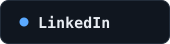</a>&nbsp;
  <a href="https://codeforces.com/profile/Ajay_2705">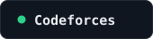</a>&nbsp;
  <a href="https://www.codechef.com/users/ajay_2705">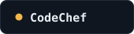</a>


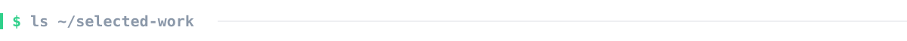

  <a href="https://github.com/Ajayendra2705/iicpc-platform"></a>
  <a href="https://github.com/Ajayendra2705/Options-Pricing-Volatility-Research"></a>
  <a href="https://github.com/Ajayendra2705/robust-mssa"></a>
  <a href="https://github.com/Ajayendra2705/nlp-seq2seq-title-generation"></a>
  <a href="https://github.com/Ajayendra2705/Almgren-Chriss"></a>
  <a href="https://github.com/Ajayendra2705/spliteasy"></a>


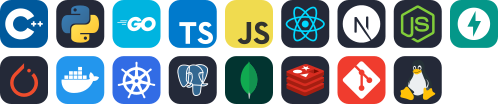

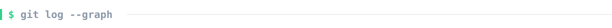

  <picture>
    <source media="(prefers-color-scheme: dark)" srcset="assets/snake-dark.svg">
    
  </picture>

